<!--
  Perfil de José Roberto Benaglia (JRFilho1503).
  Imagens que trocam com o tema (claro/escuro) usam <picture> com URL absoluta do raw,
  que é a forma suportada pelo GitHub. HEAD aponta sempre para o branch padrão.
-->

  <picture>
    <source media="(prefers-color-scheme: dark)" srcset="https://raw.githubusercontent.com/JRFilho1503/JRFilho1503/HEAD/assets/banner-dark.svg">
    <source media="(prefers-color-scheme: light)" srcset="https://raw.githubusercontent.com/JRFilho1503/JRFilho1503/HEAD/assets/banner-light.svg">
    
  </picture>

  
  &nbsp;
  
  &nbsp;
  

Engenheiro de **QA focado em automação de testes**: garanto qualidade de ponta a ponta — da reprodução do bug à homologação em esteira de release — com **testes E2E, APIs e análise de logs**. Tenho base em **Python/Django** e cada vez mais construo e testo software **lado a lado com agentes de IA**. Formado em Sistemas de Informação, em **Guarulhos/SP**, aberto a novas oportunidades.

<b>Read this in English</b>

 

**QA engineer focused on test automation.** I own end-to-end quality — from reproducing the bug to sign-off in the release train — with **E2E tests, API testing and log analysis**. I come from a **Python/Django** background and increasingly build and test software **alongside AI agents**. Information Systems graduate, based in Guarulhos, Brazil, open to new opportunities.

**About**

- 🎓 Bachelor's in **Information Systems** — UNINOVE (São Paulo).
- 🧪 **QA & automation:** end-to-end tests with **Playwright**, **Pytest**, API testing, edge-case and regression coverage.
- 🔭 **Observability:** root-cause analysis over logs with **Grafana, Loki and Prometheus**.
- 🚦 **Process:** QA in a release train (homologation, per-ticket evidence in **Jira**), **Scrum**.
- 🤖 **AI in the daily work:** QA and automation driven with agents (**Claude Code, MCP**), building my own skills and monitors in **Python**.
- 🧱 **Dev base:** Python/Django, Docker, SQL (PostgreSQL / MySQL).

## 🧰 Sobre

- 🎓 Bacharel em **Sistemas de Informação** — UNINOVE (São Paulo).
- 🧪 **QA & automação:** testes de ponta a ponta com **Playwright**, **Pytest**, testes de API, cobertura de bordas e regressão.
- 🔭 **Observabilidade:** investigação de causa-raiz em logs com **Grafana, Loki e Prometheus**.
- 🚦 **Processo:** QA em esteira de release (homologação, evidência por card no **Jira**), **Scrum**.
- 🤖 **IA no dia a dia:** QA e automação conduzidos com agentes (**Claude Code, MCP**), construindo skills e monitores próprios em **Python**.
- 🧱 **Base de dev:** Python/Django, Docker, SQL (PostgreSQL / MySQL).

## 🧪 O que eu faço em QA

| Frente | Como atuo |
| --- | --- |
| **Automação E2E** | Fluxos reais no navegador com Playwright — triagem, candidatura, funil — dirigidos por código, não só clique. |
| **Testes de API** | Valido contrato e estado real (payload/responses), cruzando UI × API pra não confiar só na tela. |
| **Cobertura de bordas** | Vou além do caminho feliz: casos negativos, limites e cenários de falha a partir do critério de aceite. |
| **Observabilidade** | Caço causa-raiz em logs de produção/staging (Grafana/Loki) antes de cravar veredito. |
| **Processo & evidência** | Homologação com evidência fresca por card no Jira, dentro da esteira de release (Scrum). |

## 🔄 Meu fluxo de QA — da reprodução à evidência

  <picture>
    <source media="(prefers-color-scheme: dark)" srcset="https://raw.githubusercontent.com/JRFilho1503/JRFilho1503/HEAD/assets/qa-flow-dark.svg">
    <source media="(prefers-color-scheme: light)" srcset="https://raw.githubusercontent.com/JRFilho1503/JRFilho1503/HEAD/assets/qa-flow-light.svg">
    
  </picture>

## 🛠️ Stack

| Área | Tecnologias |
| --- | --- |
| **Linguagens** | <code>Python</code> <code>JavaScript</code> <code>TypeScript</code> <code>SQL</code> |
| **QA&nbsp;&&nbsp;Automação** | <code>Playwright</code> <code>Pytest</code> <code>Testes&nbsp;de&nbsp;API</code> <code>REST</code> <code>CI/CD</code> |
| **Backend** | <code>Django</code> <code>Django&nbsp;REST</code> <code>Docker</code> <code>PostgreSQL</code> <code>MySQL</code> |
| **Observabilidade** | <code>Grafana</code> <code>Loki</code> <code>Prometheus</code> |
| **Dev&nbsp;&&nbsp;Ferramentas** | <code>Git</code> <code>GitHub</code> <code>Jira</code> <code>Linux</code> <code>WSL</code> <code>Scrum</code> |
| **IA&nbsp;&&nbsp;Agentes** | <code>Claude&nbsp;Code</code> <code>MCP</code> <code>Anthropic&nbsp;API</code> <code>OpenAI&nbsp;API</code> |

## 📂 Projetos

> 🧪 **[Portfólio de QA »](https://github.com/JRFilho1503/qa-portfolio)** — meu portfólio completo de Quality Assurance: estratégia e casos de teste, bug reports com evidência, automação E2E em **Playwright** (Page Object Model), testes de **API** e metodologia de **QA de IA/LLM**. É o melhor lugar pra ver como eu trabalho.

Além dele, projetos próprios de estudo e prática — o trabalho do dia a dia fica em repositórios privados de empresa:

- **[SGE](https://github.com/JRFilho1503/SGE)** — *Sistema de Gestão de Estoque* (Python): CRUD de produtos, controle de entradas/saídas e saldo, com foco em modelagem de dados e regras de negócio.
- **[flix_api](https://github.com/JRFilho1503/flix_api)** — *API REST de catálogo de filmes* (Python · Django REST): modelos, endpoints, autenticação e permissões — a base que uso pra entender e testar APIs por dentro.

  
  &nbsp;
  
  &nbsp;
  
  &nbsp;
  

## 📫 Contato

  
  &nbsp;
  
  &nbsp;
  

📍 Guarulhos, São Paulo, Brasil · <b>Disponível para novas oportunidades</b>

  <picture>
    <source media="(prefers-color-scheme: dark)" srcset="https://raw.githubusercontent.com/JRFilho1503/JRFilho1503/HEAD/assets/footer-dark.svg">
    <source media="(prefers-color-scheme: light)" srcset="https://raw.githubusercontent.com/JRFilho1503/JRFilho1503/HEAD/assets/footer-light.svg">
    
  </picture>

